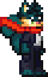
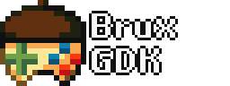
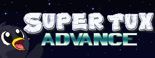

#  Kelvin Shadewing

Rew! I'm Kelvin, a shadewing who makes pixel art and programs games, mainly using C++ and Squirrel, though I have some knowledge of C#, Java, JavaScript, and Game Maker.

My main projects include:

Brux is a FOSS game engine made in SDL that uses Squirrel for scripting. It aim's to be as cross-platform as possible.

A simple platformer I started to build my game design and development skills with. It's gone on longer than planned because some people actually like it, so I'm still building it.

My dream game. Currently this repo is mostly worldbuilding and lore as I'm still using STA to nail down a good platformer system and using what I learn there before I implement this.

----

If you'd like to collaborate with me on any of this, I'd like help with testing and porting Brux onto other platforms. The embedded functions are being written to match Game Maker's closely, so anyone coming from GM will be able to easily learn it.

Anyone looking to contact me may [email me](mailto:kelvin@shadewing.net) or find me on Discord as Kelvin#0465 or Telegram as @KelvinShadewing.
